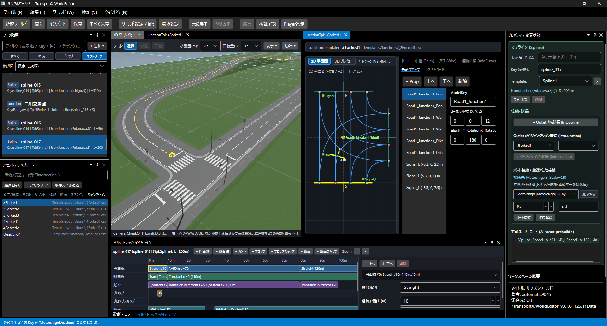

# TransportX ワールドエディタ
Copyright (c) 2026 automatic9045

https://transportx.okaoka-depot.com

[TransportX](https://github.com/automatic9045/TransportX) 用のワールドデータを GUI から編集できるエディタです。

## ライセンス
[GPL-3.0](LICENSE.txt)

## ご注意
本ソフトウェアの大部分は自律型 AI エージェントによって実装されています。基本的な動作に問題はありませんが、内部の設計や品質が十分に成熟していない箇所を多数確認しています。

多くのデータやプラグインから参照される TransportX 本体とは異なり、エディタは依存関係の末端に当たるアプリケーションです。設計上の不備が外部へ波及するケースが少なく、一定程度の品質のものを短時間で作成できるという利点を最大限生かせることから、自律型エージェントによる開発の試験的な適用先として採用しました。不具合などが含まれる可能性があることをあらかじめご了承の上、お使いください。

## ダウンロード
こちら→ [Releases](https://github.com/automatic9045/TransportX.WorldEditor/releases)

## 使用ライブラリ等（アルファベット順）
### [.NET Community Toolkit](https://github.com/CommunityToolkit/dotnet) (MIT)
Copyright © .NET Foundation and Contributors

### [.NET Runtime](https://github.com/dotnet/runtime) (MIT)
Copyright (c) .NET Foundation and Contributors

### [AssimpNetter](https://github.com/Saalvage/AssimpNetter) (Assimp: BSD-3-Clause, AssimpNetter: MIT)
Copyright (c) 2012-2020 AssimpNet - Nicholas Woodfield  
Copyright (c) 2024-2026 AssimpNetter - Stefan Koch

### [ANGLE - Almost Native Graphics Layer Engine](https://github.com/AvaloniaUI/angle)
Copyright 2018 The ANGLE Project Authors

### [Avalonia](https://github.com/AvaloniaUI/Avalonia) (MIT)
Copyright (c) AvaloniaUI OÜ

### [AvaloniaEdit](https://github.com/AvaloniaUI/AvaloniaEdit) (MIT)
Copyright (c) 2017 Eli Arbel

### [Avalonia Telemetry](https://github.com/AvaloniaUI/Avalonia.BuildServices) (MIT)
Copyright (c) 2025 AvaloniaUI OU

### [bepuphysics v2](https://github.com/bepu/bepuphysics2) (Apache-2.0)
Copyright (c) Bepu Entertainment LLC

### [CppSharp](https://github.com/mono/CppSharp) (MIT)
Copyright (c) 2016 João Matos, Dimitar Dobrev

### [DirectXTexNet](https://github.com/deng0/DirectXTexNet) (MIT)
Copyright (c) 2024 Dennis Gocke  
Copyright (c) 2016 Simon Taylor  
Copyright (c) 2011-2024 Microsoft Corp

### [Discord RPC C#](https://github.com/Lachee/discord-rpc-csharp) (MIT)
Copyright (c) 2021 Lachee

### [Dock](https://github.com/wieslawsoltes/Dock) (MIT)
Copyright (c) Wiesław Šoltés

### [dotnet](https://github.com/dotnet/dotnet) (MIT)
Copyright (c) .NET Foundation and Contributors

### [Json.NET](https://github.com/JamesNK/Newtonsoft.Json) (MIT)
Copyright (c) 2007 James Newton-King

### [MicroCom](https://github.com/kekekeks/MicroCom) (MIT)
Copyright (c) 2021 Nikita Tsukanov

### [NativeFileDialogs.NET](https://github.com/Speykious/NativeFileDialogs.NET) (Zlib)
Copyright (c) 2022 Speykious

### [R3](https://github.com/Cysharp/R3) (MIT)
Copyright (c) 2024 Cysharp, Inc.

### [Roslyn](https://github.com/dotnet/roslyn) (MIT)
Copyright (c) .NET Foundation and Contributors

### [SharpGenTools](https://github.com/SharpGenTools/SharpGenTools) (MIT)
Copyright (c) 2010-2017 Alexandre Mutel, 2017 Jeremy Koritzinsky

### [SharpGLTF](https://github.com/vpenades/SharpGLTF) (MIT)
Copyright (c) 2019 Vicente Penades

### [Silk.NET 2.X](https://github.com/dotnet/Silk.NET) (MIT)
Copyright (c) 2019-2020 Ultz Limited  
Copyright (c) 2021- .NET Foundation and Contributors

### [SkiaSharp](https://github.com/mono/SkiaSharp) (MIT)
Copyright (c) 2015-2016 Xamarin, Inc.
Copyright (c) 2017-2018 Microsoft Corporation.

### [Tmds.DBus](https://github.com/tmds/Tmds.DBus) (MIT)
Copyright 2006 Alp Toker  
Copyright 2010 Other Contributors  
Copyright 2016 Tom Deseyn

### [TransportX](https://github.com/automatic9045/TransportX) (GPL-3.0)
Copyright (c) 2026 automatic9045

### [Vanara](https://github.com/dahall/vanara) (MIT)
Copyright (c) 2017 David Hall

### [Vortice.Windows](https://github.com/amerkoleci/Vortice.Windows) (MIT)
Copyright (c) Amer Koleci and Contributors

### [VSTest](https://github.com/microsoft/vstest) (MIT)
Copyright (c) Microsoft Corporation

### [xUnit.net](https://github.com/xunit/xunit) (Apache-2.0)
Copyright (c) .NET Foundation and Contributors
